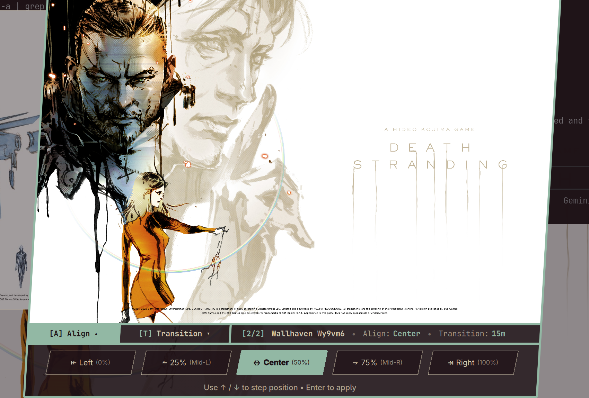

# Wallpaper Frame And Flow for Omarchy

A retro wallpaper picker with five horizontal framing positions and an automatic slideshow. Version 1.1 bundles the desktop renderer, settings, and rotation timer in one plugin for Omarchy 4.5.



## How it fits into Omarchy

Frame And Flow replaces **`omarchy.background`**, the desktop background service. Its own overlay opens under `alasdairanderson.wallpaper-frame-and-flow`. It does not replace `omarchy.image-picker`, so Omarchy's theme picker and wallpaper menus continue to work independently.

- Double-click the desktop with the **left** button to open Frame And Flow.
- Double-click with the **right** button to open Omarchy's native theme picker.
- Open the enhanced picker from a terminal or a custom keybinding with:

  ```bash
  omarchy-shell shell summon alasdairanderson.wallpaper-frame-and-flow
  ```

Omarchy's existing background shortcut/menu still opens its native picker. Wallpapers chosen there use this plugin's saved alignment when displayed. Use the command above for the alignment and slideshow controls.

The plugin preserves Omarchy 4.5's background IPC, theme transitions, monitor handling, image recovery, and OWE video handoff. Video playback is handled by Omarchy; horizontal alignment applies to still images. The slideshow controls remain available when a video is selected.

## Features

- **Alignment:** left, 25%, center, 75%, and right. The preview and desktop use the same position; each wallpaper remembers its setting.
- **Slideshow:** off, 10 seconds, 5 minutes, 15 minutes, 30 minutes, or 1 hour. Changes take effect immediately and survive shell restarts.
- **Current-theme discovery:** both stock backgrounds and user backgrounds in `~/.config/omarchy/backgrounds/<theme>/`. Rotation advances through symlinked theme directories and wraps at the end.
- **One installation:** no separate `kingbooty.background` plugin, slideshow service, or custom commands in `~/.local/bin` are required.
- **Theme-aware appearance:** colors and motion follow the shell theme and animation setting.

Settings remain compatible with earlier versions:

- `~/.config/omarchy/background-alignments.json`
- `~/.config/omarchy/background-slideshow.json`

The slideshow starts disabled when no settings exist. It skips ticks while Frame And Flow's picker is open or a previous rotation is still running. Disabling the plugin stops its timer and restores the native background service through Omarchy's clone lifecycle; saved settings remain on disk.

## Requirements

- **Omarchy 4.5** with `omarchy-shell` (Quickshell), Python 3, and ImageMagick, provided by a standard installation.
- **ffmpegthumbnailer** for video thumbnail previews.
- Omarchy's **OWE** integration for video wallpaper playback.

## Install

```bash
omarchy plugin add https://github.com/AlasdairAnderson/omarchy-wallpaper-frame-and-flow.git --enable
```

If another background replacement is enabled, restore the native background service before enabling Frame And Flow, so only one renderer owns the desktop:

```bash
omarchy plugin enable omarchy.background
omarchy plugin enable alasdairanderson.wallpaper-frame-and-flow
```

## Upgrade from 1.0

Version 1.0 replaced the shared image picker. Disable it **before updating**, while Omarchy can still read the old manifest and restore that source. Once the 1.1 changes are available from the remote repository:

```bash
omarchy plugin disable alasdairanderson.wallpaper-frame-and-flow
omarchy plugin update alasdairanderson.wallpaper-frame-and-flow
omarchy plugin enable omarchy.image-picker
omarchy plugin enable omarchy.background
omarchy plugin enable alasdairanderson.wallpaper-frame-and-flow
omarchy restart shell
```

These commands also restore the native image picker if the manifest was updated before disabling 1.0. Enabling the native background service first deactivates a previous background clone, including the old separate alignment/slideshow renderer. Existing settings are reused by the bundled service.

For subsequent updates:

```bash
omarchy plugin update alasdairanderson.wallpaper-frame-and-flow
omarchy restart shell
```

The restart reloads the plugin's keep-loaded service code.

## Disable or remove

```bash
omarchy plugin disable alasdairanderson.wallpaper-frame-and-flow
# Or:
omarchy plugin remove alasdairanderson.wallpaper-frame-and-flow
```

## Controls

| Key / action | Description |
|---|---|
| Left / Right | Navigate wallpapers |
| A | Toggle the alignment drawer (still images) |
| T | Toggle the slideshow interval drawer |
| Tab | Switch drawer tabs, or navigate when the drawer is closed |
| Up / Down | Change the active drawer's option |
| Enter | Apply the selected wallpaper and alignment |
| Escape | Close the active drawer or dismiss the picker |
| Mouse | Select wallpapers, tabs, and options |

Slideshow interval changes save immediately. Wallpaper and alignment changes apply with Enter or a click on the selected preview. An application failure keeps the picker open for retry.

## Development checks

```bash
node --test --test-isolation=none tests/compatibility.test.cjs
bash -n ipc-file.sh list.sh tests/qml-smoke.sh
omarchy plugin validate .
# Requires access to a running Wayland session; uses isolated state in /tmp.
bash tests/qml-smoke.sh
```

The smoke test compiles and instantiates the picker closed and renderer suspended; it does not install the plugin or change desktop settings. The regression tests exercise theme routing, direct application, safe file-based IPC, crop geometry, configuration limits, and real slideshow rotation through temporary fixtures.

## License

[MIT](LICENSE) © 2026 Alasdair Anderson. The bundled background service is adapted from Omarchy 4.5.0; its upstream license is included in [LICENSE.omarchy](LICENSE.omarchy).
